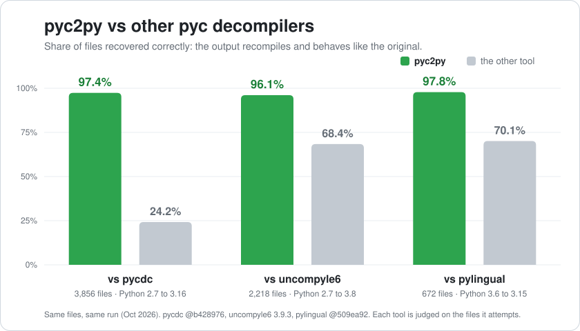

# pyc2py

*Other pyc decompilers were pretty bad, so I made my own :)*

pyc2py takes compiled Python (`.pyc` files) and gives you the source back. The
part I actually care about: it then checks itself. It recompiles the source it
just produced and compares every function, byte for byte, against the bytecode
it started from. So you don't have to take my word that the output is right,
every file it writes tells you whether it matched, didn't match, or couldn't be
checked.

It handles CPython 2.7 and 3.0 through 3.16, and PyPy 2.7 and 3.6 through 3.12.
Point it at a single file, a whole folder, a zip or wheel, a PyInstaller bundle,
or a py2exe `.exe`.

## How it stacks up

I put pyc2py up against the three decompilers people actually reach for, pycdc,
uncompyle6 and pylingual, on the same pile of real `.pyc` files, in the same
run. For every file I recompiled whatever the tool handed back and ran it; if it
behaves exactly like the original, it counts as recovered. That's a fair bar for
everyone, since nobody has to produce byte-identical bytecode, the recovered
code just has to actually work.

<picture>
  <source media="(prefers-color-scheme: dark)" srcset="assets/benchmark-dark.svg">
  
</picture>

Thousands of files spanning Python 2.7 through 3.16, with each tool scored only
on the versions it supports. pyc2py is reading every one of those versions on a
single interpreter here, the same spot pycdc and pylingual are in, no matching
Python needed.

(pyc2py actually holds itself to a stricter bar than "behaves the same": it
checks that each function recompiles to the exact original bytecode. The chart
uses the looser behaviour test only so the comparison stays fair to the others.)

## Install

You need Python 3.14 or newer to run it. That's only what pyc2py itself runs on,
the bytecode it reads can be from any of the versions above. No dependencies.

```bash
pip install .
```

That gives you the `pyc2py` command. `python -m pyc2py` does the same thing.

## Use

```bash
pyc2py module.pyc                          # writes module.pyc.py beside it
pyc2py module.pyc -o recovered             # writes recovered/module.pyc.py
pyc2py build/lib -o recovered              # every .pyc and .pyo in a folder
pyc2py build/lib -o recovered --recursive  # and in its subfolders
pyc2py package.whl -o recovered            # every .pyc in a zip, egg or wheel
pyc2py dist/app -o recovered               # a PyInstaller bundle (the executable)
pyc2py app.exe -o recovered                # a py2exe executable
```

pyc2py works out what a file is from what's inside it, not from its name. One
catch: a bare marshalled code object with no pyc header, which is what tools
that crack open frozen programs usually spit out, doesn't record which Python
built it. When that happens, tell it:

```bash
pyc2py code_object --python-version 3.12
```

`--python-version` is also how you override a header that's lying, say a
pre-release build. The output notes that you forced the version and what the
header actually claimed.

A few more flags:

- `--compact`: stop putting each statement back on its original line. By default
  I keep the original line numbers, so a traceback from the recovered code lands
  on the same lines it would in the real source.
- `--disassemble`: also drop a `<output>.dis` next to the output, every code
  object with its offsets, lines, opcodes, arguments, jump targets and exception
  table.
- `--verify-with PYTHON`: point this at an interpreter matching the file's own
  version. pyc2py can only diff bytecode against the Python it's running on, so
  with this it compiles the recovered source using the interpreter you give it
  and checks every function there instead. Pass it once per version you need.
  PyPy works too.

## What the output tells you

Every function and class body gets its own verdict, and the file as a whole
takes the worst one:

- `passed`: everything compiled straight back to the original bytecode.
- `failed`: something's off, missing, unreadable, or the input is damaged.
  Anything I couldn't recover becomes `raise NotImplementedError("pyc2py could
  not ...")`. I never guess and hope.
- `unverified`: the bytecode came from a different Python than the one running
  pyc2py, so all I could confirm is that every function is there with the same
  arguments. `--verify-with` turns these into a real `passed` or `failed`.

Each file ends with a `# pyc2py:` comment block: the bytecode's version and
magic number, the original filename, the source size and timestamp (or hash),
and, for anything that didn't pass, which functions failed and why. It sits at
the bottom on purpose, so it doesn't push the code's line numbers around.

If a module unpacks and runs hidden code, the
`exec(zlib.decompress(base64.b64decode(...)))` trick and its relatives, each
layer gets written out next to it as `<output>.layer1.py` and so on. pyc2py
peels these apart without running anything. A marshalled layer gets decompiled
and checked like any other file.

Exit codes: `0` if everything passed, `1` if anything failed, `2` if nothing
failed but some came out unverified, and `3` if nothing got decompiled at all
because the command line or the input folder was wrong.

## Python API

```python
from pyc2py import decompile, decompile_folder, decompile_to_folder

result = decompile("module.pyc")
print(result.status, result.output.path)
for unit in result.report.units:
    print(unit.name, unit.status, unit.reason)
```

## What it can't do (yet)

- Python 2.7 source won't compile under Python 3.14, so 2.7 files stay
  `unverified` unless you hand it a 2.7 interpreter with `--verify-with`.
- Some bytecode shapes aren't handled yet. When a function does come out wrong,
  its verdict says so.
- It doesn't decrypt anything. Encrypted PyInstaller archives (an option
  PyInstaller dropped in 6.0 anyway) fail one member at a time with that as the
  reason, and bytecode with remapped opcodes is out of reach.

## License

MIT, see `LICENSE`.
